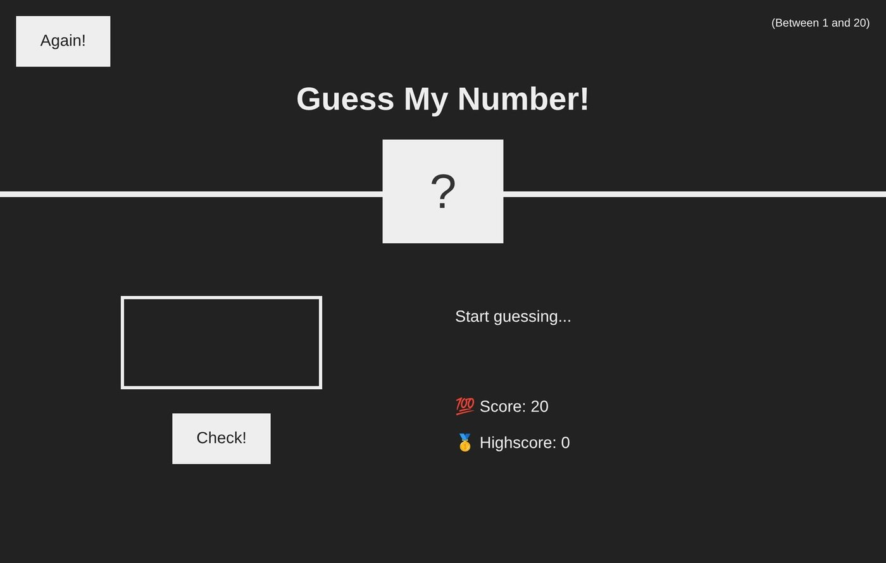
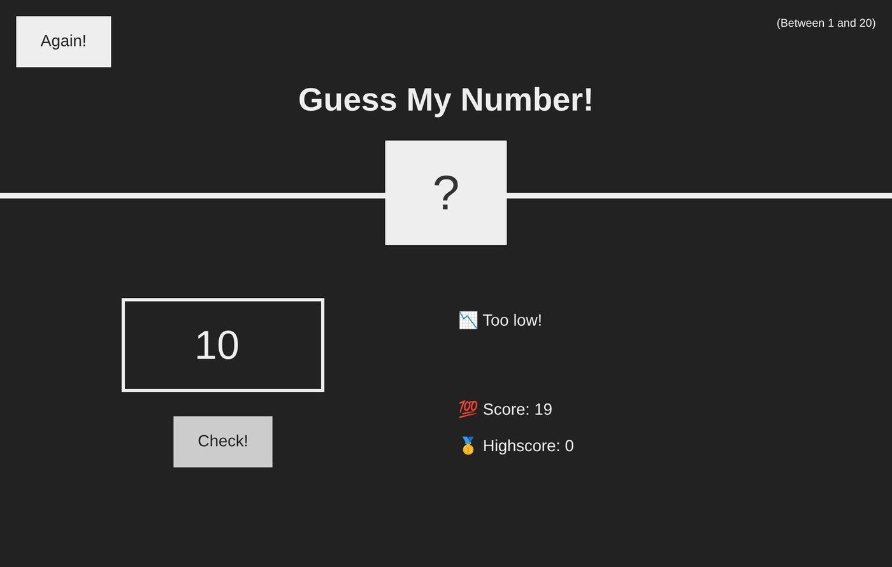
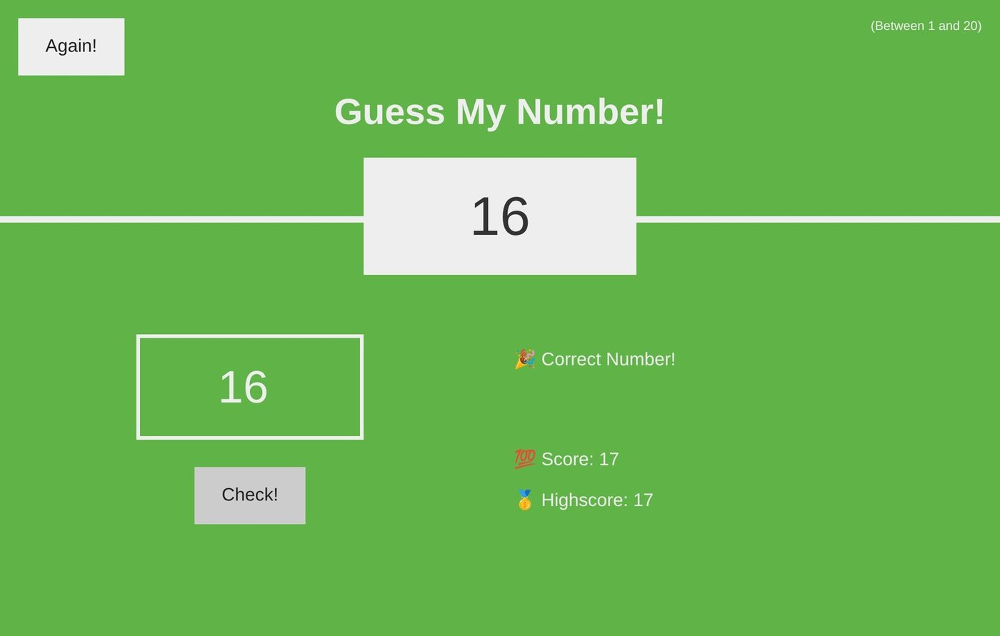

# Guess my Number

A small game where you guess a secret number between 1 and 20.

> Built while following a JavaScript course, so it shows what I learned rather than an original design.

## How it works

- Each wrong guess says whether it was too high or too low and takes one point off a score that starts at 20
- A correct guess reveals the number, turns the page green and updates the highscore
- **Again** starts a new round

## Tech

JavaScript, HTML, CSS. No dependencies.

## Run

Open `final/index.html` in a browser.

## Author

Harun Kestendžić — [GitHub](https://github.com/harunkestendzic)
